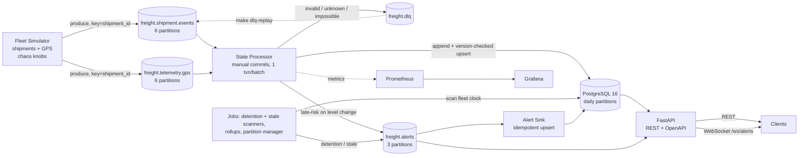

# FreightPulse

[](https://github.com/OWNER/freightpulse/actions/workflows/ci.yml)

**Near real-time freight visibility data platform.** It ingests live shipment-lifecycle and truck
GPS events, processes them in seconds into shipment state, ETAs, late-risk and detention alerts,
stores them in a well-modelled PostgreSQL schema, and serves them through a typed REST API and a
live WebSocket alert stream.

Freight brokers and shippers track thousands of loads at once, and every load emits a messy
stream of events: tendered, picked up, a GPS ping every few minutes from the truck's ELD, arrived
at the dock, delivered, plus exceptions. Those feeds arrive **out of order, duplicated, or
malformed**. Yet operations needs answers in seconds (*Where is the truck? Will it make its
delivery appointment? Is the driver stuck at a dock running up detention charges?*), and
analytics needs the same data modelled relationally to score lanes and carriers. FreightPulse
handles the whole path: **ingestion → stream processing → relational storage → API**.

> **Demo GIF placeholder.** Record `make demo` alongside the live alerts page at `/`, save it as
> `docs/demo.gif`, and replace this note with ``.

## Architecture



| Component | Code | What it does |
|---|---|---|
| Domain (pure) | `src/freightpulse/domain/` | Event contracts (Pydantic v2), state machine, ETA/HOS/haversine, alert rules, and the reducer `apply_event(state, event)`. No I/O. |
| Simulator | `src/freightpulse/simulator/` | 40 real US freight hubs and 25 carriers. Great-circle trucks at 50–65 mph, HOS breaks, log-normal dwell, ~15% tender rejections, 60× clock. Chaos knobs for duplicates, out-of-order, malformed and GPS dropout. Deterministic with `--seed`. |
| Processor | `src/freightpulse/processing/processor.py` | `confluent-kafka` consumer, manual offsets, one Postgres transaction per batch, idempotent by `event_id`, optimistic concurrency on `version`, DLQ, durable parking for unknown shipments. |
| Jobs | `processing/jobs.py`, `scanners.py`, `rollups.py` | Detention and stale-tracking scanners on the event-time fleet clock; lane and carrier rollups; partition create-ahead and retention. |
| Alert sink | `processing/alert_sink.py` | `freight.alerts` → `alerts` table, deduplicated by `dedupe_key`. |
| API | `src/freightpulse/api/` | FastAPI: keyset pagination, typed errors, `/docs`, `/ws/alerts`, a minimal live page at `/`. |
| Storage | `src/freightpulse/storage/`, `alembic/` | SQLAlchemy Core, raw SQL where clearer, 4 Alembic migrations, partition manager, COPY seeder. |
| Observability | `observability/`, `prometheus/`, `grafana/` | Prometheus metrics from every service; a provisioned Grafana dashboard. |

## Quickstart

Prerequisites: Docker (with Compose v2) and `make`. For running tests and the performance tools
on the host you also need [`uv`](https://docs.astral.sh/uv/), which installs Python 3.12 for you.

```bash
make up      # build and start everything (topics, migrations, partitions, seed are automatic)
make demo    # 500 shipments at 60x for 4 minutes; prints fleet status and new alerts
```

Then open:

| URL | What |
|---|---|
| http://localhost:8000/ | Live alerts page (WebSocket) |
| http://localhost:8000/docs | OpenAPI docs |
| http://localhost:3000 | Grafana dashboard (anonymous viewer, `admin`/`admin`) |
| http://localhost:8080 | Redpanda Console (topics, DLQ messages) |
| http://localhost:9090 | Prometheus |

The first late-risk alerts appear about 90 seconds into `make demo`. Detention alerts follow once
trucks have sat at a dock for more than 2 simulated hours, about 3 minutes in. Stale-tracking
alerts appear whenever a truck's GPS drops out for over an hour. With the default 1% dropout
that is occasional, so try `make sim ARGS="--gps-dropout-rate 0.05"` to see more of them. If port 8000 is taken on your machine, use
`make up API_PORT=8001` and `make demo API_PORT=8001`.

Try the API:

```bash
curl -s localhost:8000/metrics/summary | jq
curl -s 'localhost:8000/shipments?status=IN_TRANSIT&limit=5' | jq
curl -s 'localhost:8000/alerts?active=true&type=DETENTION' | jq '.items[0]'
SID=$(curl -s 'localhost:8000/shipments?status=IN_TRANSIT&limit=1' | jq -r '.items[0].shipment_id')
curl -s localhost:8000/shipments/$SID | jq '.eta'
curl -s localhost:8000/shipments/$SID/timeline | jq '.events[].event_type'
curl -s "localhost:8000/carriers/CAR-001/scorecard?days=30" | jq '{acceptance_rate, on_time_delivery_pct}'
```

Other useful commands (`make help` lists them all):

```bash
make test          # unit + integration + API tests (testcontainers: needs Docker)
make cov           # tests with coverage; fails if domain+processing < 80%
make lint typecheck
make dlq-replay    # re-publish everything in freight.dlq to its original topic after a fix
make seed-large    # 5M GPS pings + 1M events via COPY into the freightpulse_perf database
make sql-perf      # EXPLAIN (ANALYZE, BUFFERS) before/after case studies -> docs/sql_performance.md
make bench         # throughput + latency benchmark -> docs/benchmarks.md
make logs          # tail the app services
make down          # stop and delete all data volumes (clean slate); `make stop` keeps data
```

## API

| Method | Path | Notes |
|---|---|---|
| GET | `/health`, `/ready` | Readiness checks Postgres and the broker (503 when not ready) |
| GET | `/shipments?status=&carrier_id=&late_risk=&cursor=&limit=` | Keyset pagination: an opaque `next_cursor`, never `OFFSET` |
| GET | `/shipments/{id}` | State, stops (with dwell), ETA, stored and age-decayed confidence |
| GET | `/shipments/{id}/timeline` | Lifecycle events ordered by `event_time` |
| GET | `/shipments/{id}/track?since=` | GPS breadcrumbs |
| GET | `/alerts?active=true&type=` | Newest first; also `shipment_id=` |
| GET | `/lanes/{lane_id}/metrics?from=&to=` | From `lane_metrics_hourly` |
| GET | `/carriers/{carrier_id}/scorecard?days=30` | From `carrier_scorecard_daily`, plus a weighted summary |
| GET | `/metrics/summary` | In transit, at risk, detained now, detention cost today, ... |
| WS | `/ws/alerts` | Live alert push (consumes `freight.alerts`) |

Errors always look like `{"error": {"code": "shipment_not_found", "message": "...", "details": null}}`.

## Design decisions & trade-offs

| Decision | Trade-off | ADR |
|---|---|---|
| Redpanda (Kafka API) with every topic keyed by `shipment_id`; equal partition counts plus the range assignor, so a shipment's lifecycle and GPS land on the same processor | Ordering only within a topic; at most 6 consumers per group without repartitioning | [0001](docs/adr/0001-redpanda-and-keying.md) |
| At-least-once consumption plus idempotent writes = effectively-once. One transaction per batch, offsets committed after the DB commit; alerts and DLQ flushed *before* the commit with deterministic keys | An extra already-logged lookup per batch; alerts and DLQ are at-least-once on the wire (sinks dedupe) | [0002](docs/adr/0002-effectively-once-semantics.md) |
| Out-of-order handling with separate event-time guards for status and position, statuses that never regress, and scanners on an **event-time fleet clock** | Speed EWMA depends on arrival order; a bogus backward event that arrives first can't be detected | [0003](docs/adr/0003-out-of-order-handling.md) |
| Daily range partitions, a BRIN index for time scans, retention by `DROP`, no FK on event tables | Per-shipment queries probe every partition; retention keeps that bounded | [0004](docs/adr/0004-partitioning-strategy.md) |

Other notable choices:
- **Pure domain layer.** All business rules live in one reducer with no I/O. Hypothesis checks
  that random event sequences never regress status, that any shuffle of a valid lifecycle
  converges to the same state, and that duplicates are idempotent.
- **Unknown shipments are parked in Postgres, not held in memory.** Offsets can be committed
  safely. Events expire to the DLQ after 30 s if `shipment.created` never arrives.
- **GPS re-anchoring.** A corrupt *first* fix can't be checked against anything. If the next two
  pings agree with each other but not with the anchor, the anchor was the outlier, so the track
  re-anchors instead of dead-lettering every good ping afterwards.
- **The crash test is real.** The processor runs as a subprocess and is hard-killed
  (`os._exit(137)`) before and after the DB commit, and also SIGKILLed at a random moment. The
  tests then assert exact row counts after a restart.

## Results

Measured on an Apple M5 Pro laptop with Redpanda and Postgres in a 4-CPU Docker VM. Full
methodology and raw outputs are in [docs/benchmarks.md](docs/benchmarks.md) and
[docs/sql_performance.md](docs/sql_performance.md).

| Metric | Result |
|---|---|
| Sustained throughput, 1 processor (500k-event backlog drain) | **9,922 events/s** |
| Sustained throughput, 3 processors (one consumer group) | **21,360 events/s** (2.15x) |
| End-to-end latency at 7,980 ev/s, 1 processor (produced_at → Postgres commit) | p50 182 ms · **p95 241 ms** · p99 266 ms |
| End-to-end latency at 7,962 ev/s, 3 processors | p50 279 ms · **p95 443 ms** · p99 477 ms |
| Worst p95 across the 1k–8k ev/s sweep | 1 processor 681 ms (at 4,000/s) · 3 processors 443 ms (at 8,000/s) |
| SQL: Timeline query: composite index vs seq scan | 31.9 ms → 0.201 ms (**159x**) |
| SQL: GPS 2-hour range: no pruning, PK scan → pruning + BRIN | 37.6 ms → 1.675 ms (**22x**) |
| SQL: Shipment list page 2,001: `OFFSET 100000` → keyset | 48.3 ms → 0.098 ms (**493x**) |
| SQL: Carrier scorecard: raw aggregation → rollup table | 68.4 ms → 0.017 ms (**4,025x**) |
| SQL: Active alerts per shipment: no index → partial index | 10.5 ms → 0.010 ms (**1,055x**) |
| BRIN vs B-tree on `gps_pings.event_time` (5M rows) | BRIN 960 kB, 1.68 ms · B-tree 107.9 MB, 1.64 ms |

## Testing

```bash
make test-unit         # ~100 unit + property tests, no Docker
make test-integration  # Redpanda + Postgres testcontainers: processor, crash, DLQ, alerts, API
make cov               # coverage gate on domain + processing
```

Covered: ETA, HOS and haversine math; the state machine (Hypothesis); simulator determinism and
chaos rates; duplicates producing exactly one row; shuffled order giving the same final state;
malformed, invalid and impossible events landing in the DLQ; crash and restart losing nothing and
duplicating nothing; three concurrent processors sharing work without deadlocks; parking and expiry; DLQ replay; scanner escalation and resolution; sink
idempotency; rollups; and every API endpoint, including a live WebSocket push.

## What I'd do next at scale

- **Avro/Protobuf + a schema registry** instead of JSON with a `schema_version` field: compact
  payloads, enforced compatibility rules, and generated types for producers in other languages.
- **Flink or Kafka Streams** for the stateful parts (per-shipment state, windowed dwell and
  detention, watermarks), with RocksDB state and exactly-once sinks instead of hand-rolled
  batching.
- **CDC (Debezium) from the TMS** instead of the TMS publishing events itself: tenders,
  appointments and rate changes captured from the source of truth with no dual writes.
- **A lakehouse sink (Apache Iceberg)** for the raw event log. Cheap long retention,
  time-travel, and ML features (ETA models trained on real transit and dwell history) without
  loading the OLTP database.
- **Multi-region**: regional Kafka clusters with MirrorMaker 2 or Cluster Linking, Postgres
  read replicas for the API, and shipment-keyed routing so each load is owned by one region.
- Partition-level parallelism inside a processor, a per-shipment reorder buffer for the rare
  "backward event arrives first" case, and real HOS logs from ELDs instead of inferring them
  from ping status.

## Repository layout

```
├── alembic/                 # 4 migrations (hand-written SQL; partitioned tables)
├── docs/adr/                # 0001 keying, 0002 effectively-once, 0003 out-of-order, 0004 partitioning
├── docs/sql_performance.md  # generated by make sql-perf
├── docs/benchmarks.md       # generated by make bench
├── grafana/, prometheus/    # provisioned dashboard + scrape config
├── src/freightpulse/
│   ├── config.py            # pydantic-settings (FREIGHTPULSE_*)
│   ├── domain/              # pure: events, state machine, ETA/HOS, alerts, reducer
│   ├── simulator/           # fleet simulation + chaos + producer + CLI
│   ├── processing/          # processor, DLQ + replay, scanners, rollups, alert sink, jobs
│   ├── storage/             # Core tables, repositories, partitions, seeds
│   ├── api/                 # FastAPI app, queries, schemas, WebSocket
│   ├── observability/       # Prometheus metrics
│   └── perf/                # SQL case studies + benchmark harness
└── tests/{unit,integration,api}/
```

The build log, including every decision and every deviation from SPEC.md, is in
[PROGRESS.md](PROGRESS.md).
