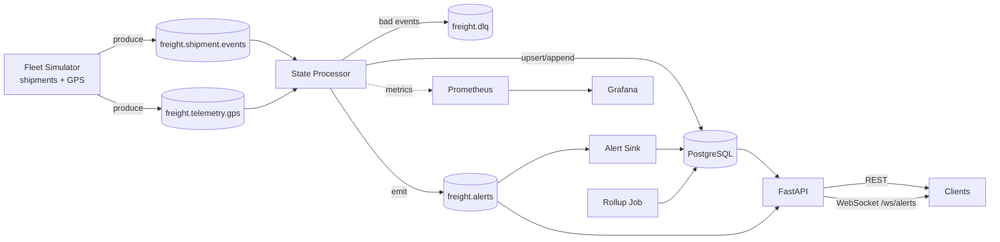

# FreightPulse — Near Real-Time Freight Visibility Data Platform

> An event-driven data platform that ingests live freight events (shipment lifecycle + truck GPS telemetry), processes them in near real time to compute shipment state, ETAs, late-risk and detention alerts, stores them in a well-modeled relational database, and serves them through a typed API and a live alert stream.

This spec is written to be handed to Claude Code and built **phase by phase**. Each phase must end in a working, tested, committed state.

---

## 1. Why this project exists (the story for the README)

Freight brokers and shippers track thousands of loads at once. Each load produces a stream of events: tendered, picked up, GPS pings every few minutes, arrived at a facility, delivered, plus exceptions. The hard data problems are:

- Events arrive **out of order, duplicated, or malformed** (ELD/telematics feeds are messy).
- Operations teams need answers **in seconds**, not overnight: *Where is the truck? Will it make its appointment? Is the driver stuck at a dock accruing detention?*
- Analytics teams need the same data **modeled relationally** for lane and carrier performance.

FreightPulse solves this end to end: **ingestion → stream processing → relational storage → API consumption**.

---

## 2. Tech stack (keep it exactly this unless there's a strong reason)

| Layer | Choice | Why |
|---|---|---|
| Language | Python 3.12 | Role requires advanced Python |
| Message broker | **Redpanda** (Kafka API compatible) via Docker | Kafka semantics, single binary, light on a laptop |
| Kafka client | `confluent-kafka` | Industry-standard, fast |
| Schemas / validation | Pydantic v2 models, JSON-serialized, schema version field on every event | Typed contracts between producers and consumers |
| Stream processing | Plain Python consumer services using `confluent-kafka` (no framework) | Shows understanding of offsets, commits, idempotency, and ordering rather than hiding them behind a framework |
| Database | **PostgreSQL 16** with native declarative partitioning | Relational modeling plus SQL performance work |
| DB access | SQLAlchemy 2.0 Core + `psycopg` 3, Alembic migrations | Explicit SQL, versioned schema |
| API | **FastAPI** + Uvicorn, WebSocket for live alerts | Async, typed, auto OpenAPI docs |
| Observability | `prometheus-client` metrics + Prometheus + Grafana (docker-compose) | Consumer lag, throughput, latency |
| Testing | `pytest`, `testcontainers` (Postgres + Redpanda), `hypothesis` for the state machine | Real integration tests |
| Quality | `ruff`, `mypy --strict` on `src/`, `pre-commit` | Clean, professional repo |
| CI | GitHub Actions: lint, type-check, unit and integration tests | Green badge on README |
| Orchestration | `docker-compose.yml` + `Makefile` | `make up && make demo` runs everything |

---

## 3. Architecture



### Kafka topics

| Topic | Key | Partitions | Purpose |
|---|---|---|---|
| `freight.shipment.events` | `shipment_id` | 6 | Lifecycle events |
| `freight.telemetry.gps` | `shipment_id` | 6 | Truck position pings |
| `freight.alerts` | `shipment_id` | 3 | Derived alerts (late risk, detention, stale tracking) |
| `freight.dlq` | original key | 1 | Invalid or unprocessable events with an error reason |

**Keying by `shipment_id`** guarantees per-shipment ordering within a partition. Document this decision in an ADR.

---

## 4. Domain model and event contracts

### 4.1 Event envelope (every event)

```python
class EventEnvelope(BaseModel):
    event_id: UUID            # globally unique, used for idempotency
    event_type: str
    schema_version: int = 1
    shipment_id: str          # e.g. "SHP-000123"
    event_time: datetime      # when it happened in the real world (UTC)
    produced_at: datetime     # when the producer sent it
    source: str               # "eld:samsara-sim", "tms", "carrier-api"
    payload: dict
```

### 4.2 Event types

| event_type | Payload highlights |
|---|---|
| `shipment.created` | customer_id, mode (FTL/LTL), equipment (dry_van/reefer/flatbed), stops[] with facility_id, type, appointment window |
| `shipment.tendered` | carrier_id, rate_usd |
| `shipment.tender_accepted` / `shipment.tender_rejected` | carrier_id |
| `stop.arrived` | stop_sequence, facility_id |
| `stop.departed` | stop_sequence, facility_id |
| `shipment.delivered` | pod_signed_by |
| `shipment.exception` | code (WEATHER, BREAKDOWN, RECEIVER_CLOSED…), note |
| `gps.ping` (telemetry topic) | lat, lon, speed_mph, heading, odometer_mi, driver_status (DRIVING/ON_DUTY/OFF_DUTY/SLEEPER) |

### 4.3 Shipment state machine

```
CREATED → TENDERED → ACCEPTED → AT_PICKUP → IN_TRANSIT → AT_DELIVERY → DELIVERED
              ↘ REJECTED → TENDERED (re-tender)
Any active state → EXCEPTION → (back to the prior active state on resolution)
```

Invalid transitions (for example `DELIVERED → IN_TRANSIT`) go to the DLQ with reason `INVALID_TRANSITION`, **unless** they are explained by out-of-order arrival (see section 6).

---

## 5. Relational data model (PostgreSQL)

Normalize the reference data and keep the event log append-only. Write all of it as Alembic migrations.

```sql
carriers(carrier_id PK, name, scac, mc_number, created_at)
customers(customer_id PK, name)
facilities(facility_id PK, name, city, state, lat, lon, timezone, avg_dwell_min)
lanes(lane_id PK, origin_facility_id FK, dest_facility_id FK, distance_mi,
      UNIQUE(origin_facility_id, dest_facility_id))

shipments(shipment_id PK, customer_id FK, carrier_id FK NULL, lane_id FK,
          mode, equipment, status, rate_usd, created_at, updated_at)

shipment_stops(shipment_id FK, stop_sequence, facility_id FK, stop_type,
               appt_start, appt_end, arrived_at NULL, departed_at NULL,
               PRIMARY KEY (shipment_id, stop_sequence))

-- Append-only, partitioned by day on event_time
shipment_events(event_id UUID, shipment_id, event_type, event_time, ingested_at,
                source, payload JSONB,
                PRIMARY KEY (event_id, event_time)) PARTITION BY RANGE (event_time)

-- High volume, partitioned by day, BRIN index on event_time
gps_pings(event_id UUID, shipment_id, event_time, lat, lon, speed_mph,
          driver_status, ingested_at,
          PRIMARY KEY (event_id, event_time)) PARTITION BY RANGE (event_time)

-- One row per shipment, current snapshot (what the API reads)
shipment_current_state(shipment_id PK FK, status, last_lat, last_lon,
                       last_ping_at, next_stop_sequence, eta, eta_confidence,
                       late_risk (LOW/MEDIUM/HIGH), miles_remaining,
                       last_event_time, version BIGINT, updated_at)

alerts(alert_id PK, shipment_id FK, alert_type, severity, message,
       triggered_at, resolved_at NULL, dedupe_key UNIQUE)

-- Rollups for analytics
lane_metrics_hourly(lane_id, hour_bucket, shipments_delivered, on_time_pct,
                    avg_transit_hours, p90_transit_hours, avg_detention_min,
                    PRIMARY KEY (lane_id, hour_bucket))
carrier_scorecard_daily(carrier_id, day, tenders, acceptance_rate,
                        on_time_pickup_pct, on_time_delivery_pct,
                        tracking_compliance_pct, PRIMARY KEY (carrier_id, day))
```

Requirements:
- A partition-management job that creates partitions 7 days ahead and drops partitions older than N days (configurable).
- Explicit indexes, each justified in `docs/sql_performance.md`.

---

## 6. Stream processing logic (the core of the project)

### 6.1 Delivery semantics (state these in an ADR)

- **At-least-once consumption plus idempotent writes = effectively-once results.**
- `enable.auto.commit=false`. For each batch: validate → write to Postgres in **one transaction** → then commit offsets.
- Idempotency: `INSERT ... ON CONFLICT (event_id, event_time) DO NOTHING` on event tables. Alerts deduplicate with `dedupe_key` (for example `detention:{shipment_id}:{stop_sequence}`).
- Crash test: kill the processor mid-batch, restart it, and assert there are no duplicates and no lost events.

### 6.2 Out-of-order and late events

- Always append to the event log, whatever the arrival order.
- `shipment_current_state` position fields update **only if `event_time > last_event_time`** (optimistic concurrency with the `version` column).
- Status transitions: if an older lifecycle event arrives after a newer one, record it and backfill `shipment_stops.arrived_at/departed_at`, but **do not regress status**.
- Track and expose a metric for `events_out_of_order_total` and `event_lateness_seconds` (histogram).

### 6.3 Derived computations

1. **ETA**
   - `miles_remaining` = haversine(current position → next stop) × 1.18 road-circuity factor
   - Speed = EWMA of recent moving pings (ignore pings below 5 mph)
   - **Hours-of-service awareness**: a driver gets 11 driving hours, then needs a 10-hour break. If the remaining drive time exceeds the driver's remaining HOS hours, add the break to the ETA.
   - `eta_confidence` drops when pings are stale or speed variance is high.
2. **Late-risk alert**: compare the ETA to the next stop's `appt_end`.
   - MEDIUM if within 30 minutes of the window end, HIGH if past it. Emit only on a level change, not on every ping.
3. **Detention alert**: `stop.arrived` with no `stop.departed` after **2 hours** of free time. A periodic scanner checks this every minute. Severity rises at 3 and 4 hours. Include an estimated detention cost (for example $75/hour after free time).
4. **Stale-tracking alert**: no GPS ping for more than 60 minutes on an IN_TRANSIT shipment.
5. **Dwell time** per facility, fed into `facilities.avg_dwell_min` and the rollups.

### 6.4 Bad data → DLQ

Route to `freight.dlq` with `{original_event, error_type, error_detail, failed_at}`. Error types to cover:
- schema validation failure
- unknown shipment_id (after a short retry, since `shipment.created` may lag)
- invalid state transition
- impossible GPS jump (implied speed above 100 mph between pings)

Add a `make dlq-replay` command that reprocesses DLQ events after a fix.

---

## 7. Fleet simulator (realistic synthetic data)

`src/freightpulse/simulator/`
- Seed about 40 real US freight facilities (DCs and ports, for example in Dallas, Atlanta, Chicago, Memphis, Columbus, Ontario CA, Savannah, Laredo) with real lat/lon, plus about 25 fake carriers with SCAC codes.
- Generate N concurrent shipments (CLI flag, default 500) on lanes between facilities.
- Trucks move along a great-circle path at 50–65 mph with noise, emitting a ping every 30–120 seconds of **simulated** time. Add a time-acceleration factor, for example 60× (one real second equals one simulated minute).
- Simulate HOS breaks, facility dwell (log-normal), and tender rejections (about 15%).
- **Chaos knobs** (CLI flags):
  - `--duplicate-rate` (default 0.02)
  - `--out-of-order-rate` (default 0.03, delayed 1–10 minutes)
  - `--malformed-rate` (default 0.005)
  - `--gps-dropout-rate` (default 0.01)
- Deterministic with `--seed`.

---

## 8. API (FastAPI)

| Method | Path | Notes |
|---|---|---|
| GET | `/health`, `/ready` | Readiness checks Postgres + broker |
| GET | `/shipments?status=&carrier_id=&late_risk=&cursor=&limit=` | **Keyset (cursor) pagination**, not OFFSET |
| GET | `/shipments/{id}` | Current state + stops + ETA |
| GET | `/shipments/{id}/timeline` | Ordered event history (by event_time) |
| GET | `/shipments/{id}/track?since=` | GPS breadcrumbs |
| GET | `/alerts?active=true&type=` | |
| GET | `/lanes/{lane_id}/metrics?from=&to=` | From the rollup tables |
| GET | `/carriers/{carrier_id}/scorecard?days=30` | |
| GET | `/metrics/summary` | Fleet-wide: in transit, at risk, detention cost today |
| WS | `/ws/alerts` | Pushes new alerts live (consumes `freight.alerts`) |

Pydantic response models, typed errors, OpenAPI docs at `/docs`. Optional: one simple HTML page at `/` showing live alerts over the WebSocket. Keep it minimal; this is a backend project.

---

## 9. SQL performance work (must be documented)

Create `docs/sql_performance.md` with at least **4 before/after case studies**, each with the query, `EXPLAIN (ANALYZE, BUFFERS)` output before, the change, the output after, and timings. Run them against at least **5 million GPS pings and 1 million events** (add `make seed-large` to generate these directly with `COPY`). Suggested cases:

1. Timeline query: composite index `(shipment_id, event_time)` versus a sequential scan.
2. GPS range query: **BRIN** index on `event_time` versus B-tree (compare size and speed), plus partition pruning.
3. Shipment list: keyset pagination versus `OFFSET 100000`.
4. Carrier scorecard: raw aggregation over events versus the rollup table (or a materialized view with `REFRESH CONCURRENTLY`).
5. (Bonus) Partial index on `alerts (shipment_id) WHERE resolved_at IS NULL`.

---

## 10. Observability

Prometheus metrics from each service:
- `events_consumed_total{topic,event_type}`, `events_dlq_total{error_type}`
- `processing_latency_seconds` (histogram, produced_at → committed to DB) — **the headline "near real-time" number**
- `consumer_lag{topic,partition}`
- `db_write_batch_seconds`, `alerts_emitted_total{type,severity}`

Provision a Grafana dashboard JSON in the repo, loaded automatically by docker-compose.

---

## 11. Testing requirements

- **Unit**: ETA math, HOS logic, haversine, state machine (with `hypothesis`: random event sequences never produce an invalid status regression).
- **Integration** (testcontainers): produce events → processor → assert database state.
  - Duplicate events produce exactly one row.
  - Shuffled event order produces the same final state as the ordered sequence.
  - Malformed events land in the DLQ.
  - Crash and restart mid-batch produce no loss and no duplicates.
- **API**: endpoint tests against a seeded database.
- Target: at least 80% coverage on `src/freightpulse/processing` and `src/freightpulse/domain`.

---

## 12. Benchmark

`make bench` runs the simulator at increasing rates and reports:
- Sustained throughput (events/sec) for one processor instance and for three instances (consumer group scaling)
- p50/p95/p99 end-to-end latency
- Results are written to `docs/benchmarks.md` along with the machine specs.
**Report real measured numbers. Never invent them.**

---

## 13. Repository layout

```
freightpulse/
├── README.md
├── SPEC.md
├── CLAUDE.md
├── Makefile
├── docker-compose.yml
├── pyproject.toml
├── .github/workflows/ci.yml
├── alembic/
├── docs/
│   ├── adr/0001-redpanda-and-keying.md
│   ├── adr/0002-effectively-once-semantics.md
│   ├── adr/0003-out-of-order-handling.md
│   ├── adr/0004-partitioning-strategy.md
│   ├── sql_performance.md
│   └── benchmarks.md
├── grafana/
├── src/freightpulse/
│   ├── config.py
│   ├── domain/         # pydantic models, state machine, ETA/HOS logic (pure, no I/O)
│   ├── simulator/
│   ├── processing/     # consumers, batching, DLQ, alert scanners, rollups
│   ├── storage/        # SQLAlchemy tables, repositories, partition manager
│   ├── api/
│   └── observability/
└── tests/{unit,integration,api}/
```

---

## 14. Build phases (for Claude Code)

Build **one phase at a time**. At the end of each phase: tests pass, `ruff` and `mypy` are clean, the README is updated, and you stop for my review before the next phase.

1. **Scaffold**: pyproject, Makefile, docker-compose (Redpanda, Postgres, Redpanda Console), CI, pre-commit, config via `pydantic-settings`.
2. **Domain**: event models, state machine, geo/ETA/HOS logic, plus unit and property tests. No I/O.
3. **Storage**: Alembic migrations for the full schema, partition manager, reference-data seed.
4. **Simulator**: realistic producer with chaos knobs.
5. **Processor**: consumer with manual commits, idempotent transactional writes, out-of-order handling, DLQ, plus integration tests (including the crash test).
6. **Alerts and rollups**: late-risk, detention, and stale-tracking scanners; lane and carrier rollups; alert sink.
7. **API**: REST plus WebSocket, keyset pagination, API tests.
8. **Observability**: metrics, Prometheus, Grafana dashboard.
9. **Performance**: `seed-large`, SQL case studies, `make bench`, docs.
10. **Polish**: README with architecture diagram, quickstart, design decisions, results table, demo GIF placeholder, ADRs.

---

## 15. README must include

- A one-paragraph problem statement in freight terms
- An architecture diagram (Mermaid)
- `make up && make demo` quickstart (under 5 minutes from clone to live alerts)
- A **Design decisions & trade-offs** section linking the ADRs
- A results table: throughput, p95 latency, and SQL before/after speedups
- A **What I'd do next at scale** section: Avro/Protobuf + schema registry, Flink or Kafka Streams for stateful windows, CDC (Debezium) from the TMS, a lakehouse sink (Iceberg) for ML features, multi-region
